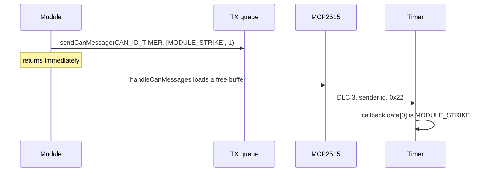
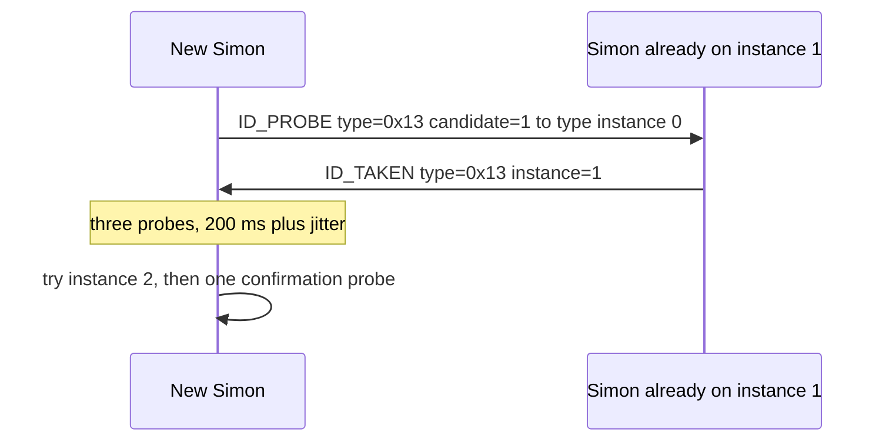

# CAN protocol

`shared_libs/can_bus/` is the wire format. Gameplay code calls `initCanBus`, `sendCanMessage`, and `handleCanMessages`. It does not call `MCP_CAN` directly.

Controller: MCP2515, 8 MHz crystal, 500 kbit/s, standard 11-bit frames, one-shot TX. SPI0 chip select is GP17. Interrupt is GP20, active low, falling edge. `can_bus` also polls the pin, because a flag can be missed.

`initCanBus` does not `delay` or recurse if `begin` fails. `handleCanMessages` retries about once a second.

## Identifier

```text
10        5 4        0
MMMMMM IIIII
type     instance
```

```cpp
constexpr uint16_t CAN_INSTANCE_ID(uint8_t moduleType, uint8_t instanceId);
// ((moduleType & 0x3F) << 5) | (instanceId & 0x1F)
```

| Constant | Type | Id | Who |
|---|---|---|---|
| `CAN_TYPE_TIMER` | `0x00` | `0x000` | one timer |
| `CAN_TYPE_AUDIO` | `0x01` | `0x020` | one audio module |
| `CAN_TYPE_WIRES` … `CAN_TYPE_PASSWORD` | `0x10` … `0x1A` | negotiated | gameplay |
| `CAN_TYPE_SIMON` | `0x13` | negotiated | Simon Says |
| `CAN_TYPE_SERIAL_DISPLAY` | `0x20` | `0x400` | serial tag |
| `CAN_TYPE_INDICATOR_PANEL` | `0x21` | `0x420` | planned |
| `CAN_TYPE_BATTERY_HOLDER` | `0x22` | `0x440` | planned |
| `CAN_TYPE_PORT_PANEL` | `0x23` | `0x460` | planned |
| `CAN_TYPE_VENTING_GAS` | `0x30` | negotiated | needy, planned |
| `CAN_TYPE_CAPACITOR_DISCHARGE` | `0x31` | negotiated | needy, planned |
| `CAN_TYPE_KNOB` | `0x32` | negotiated | needy, planned |
| `CAN_TYPE_DEBUGGER` | `0x3C` | `0x780` | harness only |
| `CAN_TYPE_DEBUGGER_SENDER` | `0x3D` | `0x7A0` | harness only |
| `CAN_TYPE_BROADCAST` | `0x3F` | `0x7E0` | timer fan-out |

Reserved ranges: `0x02`–`0x0F`, `0x1B`–`0x1F`, `0x24`–`0x2F`, `0x33`–`0x3B`. Add a new type to `can_bus.h` and to the `CAN_MODULE_TYPES` array. A duplicate value fails `static_assert`.

`getModuleTypeName` only names timer, audio, simon, serial display, and broadcast. Extend it when you add a type, or logs say `UNKNOWN`.

A Simon that wins instance 1 sits at `(0x13 << 5) | 1` = `0x261`.

## Frame

`sendCanMessage(receiverId, data, len)` copies the caller's bytes into a queue and returns. It does not wait for a free controller buffer or for the transceiver. `false` means the frame was not queued.

- `len` is 1..6. Longer calls are dropped.
- The sender id is written when a TX buffer is loaded, so a frame queued during id negotiation goes out with the final id.
- The newest `TIMER_TIME`, `TIMER_STRIKES`, `TIMER_COUNTDOWN`, `MODULE_HEARTBEAT`, and `MODULE_STATUS` replace an older queued copy of the same type and destination. Strikes, solved, register, game start/stop, and serial halves stay ahead of heartbeats when the queue is full.
- A one-shot error (no ACK, arbitration loss) is retried up to three times from `handleCanMessages`. Nothing on that path calls `delay`.

On the wire the MCP2515 DLC is `len + 2`:

```text
byte 0..1   sender id, big-endian
byte 2..    caller payload, data[0] is the message type
```

The callback is `void(uint16_t id, uint16_t senderId, const uint8_t* data, uint8_t len)`. `id` is the destination. `data` is already the caller's bytes.

Callbacks run only when the destination is this module or `CAN_ID_BROADCAST`. `registerCanCallback` holds up to 8. `registerRawCanCallback` (max 2) sees every id, including other modules' traffic, with the same prefix stripped. Hardware masks normally accept this module's type (any instance) and the broadcast id. A raw callback opens the masks.



## Id negotiation

Fixed modules call `initCanBus(CAN_ID_AUDIO)` or `initCanBus(CAN_ID_SERIAL_DISPLAY)` and skip `assignUniqueId`. `assignUniqueId` returns false on the timer.

Gameplay modules:

```cpp
initCanBus(CAN_INSTANCE_ID(CAN_TYPE_WIRES, 0x00));
assignUniqueId(CAN_TYPE_WIRES);
```

`assignUniqueId` only arms a state machine. The instance is valid after `isCanIdReady()` becomes true inside `loop`. `module_state` will not register or heartbeat before then.

`handleCanMessages` sends a raw 3-byte `[ID_PROBE, type, candidate]` to `CAN_INSTANCE_ID(type, 0)` and waits on `millis()`, so `loop` keeps running. A module that already holds that instance replies `[ID_TAKEN, type, instance]`. `ID_TAKEN` counts only when the instance matches the candidate being probed.



Instance 0 is never a live gameplay id. Negotiation starts at instance 1. On total failure the module keeps instance 1. Probe and taken frames are not delivered through the normal callback, and they are not logged.

## Timer to modules

Usually sent to `CAN_ID_BROADCAST`. `TIMER_MODULE_DISCOVERED` goes to the module's own id.

| Enum | Byte 0 | Rest |
|---|---|---|
| `TIMER_GAME_START` | `0x10` | `GameState` |
| `TIMER_GAME_STOP` | `0x11` | `GameState` |
| `TIMER_STRIKES` | `0x12` | strike count |
| `TIMER_SERIAL_NUMBER_FIRST_HALF` | `0x13` | 3 ASCII chars |
| `TIMER_SERIAL_NUMBER_LAST_HALF` | `0x14` | 3 ASCII chars |
| `TIMER_RESET` | `0x15` | |
| `TIMER_TIME` | `0x16` | bytes 1..4, remaining ms, `memcpy` of `unsigned long` |
| `TIMER_COUNTDOWN` | `0x17` | seconds |
| `TIMER_MODULE_DISCOVERED` | `0x18` | sent to the module, not broadcast |

A 6-character serial plus a type byte does not fit in one prefixed frame, so the serial is split in half.

`GameState` bytes: `IDLE` 0, `RUNNING` 1, `PAUSED` 2, `EXPLODED` 3, `DEFUSED` 4, `VICTORY` 5.

## Modules to the timer

Destination `CAN_ID_TIMER`.

| Enum | Byte 0 | Notes |
|---|---|---|
| `MODULE_REGISTER` | `0x20` | until `TIMER_MODULE_DISCOVERED` |
| `MODULE_SOLVED` | `0x21` | |
| `MODULE_STRIKE` | `0x22` | |
| `MODULE_STATUS` | `0x23` | byte 1 status, byte 2 solved (0/1), byte 3 progress |
| `MODULE_HEARTBEAT` | `0x24` | byte 1 status, byte 2 solved (0/1), byte 3 progress |
| `MODULE_TELEMETRY` | `0x25` | |

`ModuleStatus`: `IDLE` 0, `ACTIVE` 1, `SOLVED` 2, `ARMED` 3, `ERROR` 0xFF.

`MODULE_TELEMETRY_FLAG` is `0x80` on a status byte. Telemetry subtypes: `MODULE_TELEMETRY_GENERAL` `0x40`, `CUSTOM0`..`CUSTOM2` `0x41`..`0x43`.

## Audio

Destination `CAN_ID_AUDIO`. One code per byte. `module_state->playAudio` can pack several codes into one frame (up to 6).

| Enum | Value | File on the audio SD card |
|---|---|---|
| `AUDIO_PLAY_TITLE` | `0x40` | `/sounds/title.wav` |
| `AUDIO_PLAY_BEEP_NORMAL` | `0x41` | `/sounds/double_beep.wav` |
| `AUDIO_PLAY_BEEP_FAST` | `0x42` | `/sounds/double_beep_125.wav` |
| `AUDIO_PLAY_BEEP_HIGH` | `0x43` | `/sounds/time_beep_high.wav` |
| `AUDIO_PLAY_STRIKE` | `0x44` | `/sounds/strike.wav` |
| `AUDIO_PLAY_DEFUSED` | `0x45` | `/sounds/bomb_defused.wav` |
| `AUDIO_PLAY_EXPLODED` | `0x46` | `/sounds/explosion.wav` |
| `AUDIO_PLAY_CORRECT_TIME` | `0x47` | `/sounds/correct_digital_chime.wav` |
| `AUDIO_PLAY_GAME_OVER_FANFARE` | `0x48` | `/sounds/game_over_fanfare.wav` |
| `AUDIO_PLAY_ALARM_CLOCK_BEEP` | `0x49` | `/sounds/alarm_clock_beep.wav` |
| `AUDIO_PLAY_ALARM_CLOCK_SNOOZE` | `0x4A` | `/sounds/alarm_clock_snooze.wav` |
| `AUDIO_PLAY_ALARM_EMERGENCY` | `0x4B` | `/sounds/alarm_emergency.wav` |
| `AUDIO_PLAY_SIMON_RED` | `0x4C` | `/sounds/simon_red.wav` |
| `AUDIO_PLAY_SIMON_GREEN` | `0x4D` | `/sounds/simon_green.wav` |
| `AUDIO_PLAY_SIMON_YELLOW` | `0x4E` | `/sounds/simon_yellow.wav` |
| `AUDIO_PLAY_SIMON_BLUE` | `0x4F` | `/sounds/simon_blue.wav` |
| `AUDIO_SET_VOLUME` | `0x60` | byte 1 is percent 0..100 |

Volume scales mixed PCM. It does not rewrite the codec headphone PGA.

## Serial display commands

Destination `CAN_ID_SERIAL_DISPLAY`.

| Enum | Value | Payload |
|---|---|---|
| `SERIAL_DISPLAY_SET_SERIAL` | `0x30` | 6 ASCII chars. Needs 7 bytes, which `sendCanMessage` drops. The live path is the two timer serial-half messages. |
| `SERIAL_DISPLAY_CLEAR` | `0x31` | |
| `SERIAL_DISPLAY_SHOW_CREDIT` | `0x32` | |

## Logging

Automatic TX/RX logs are off. `setCanBusLogging(true)` queues them. `handleCanMessages` prints at most one line per call so the UART cannot stall the controller. Drops and RX overflows print at most once a second. `getCanBusCounters()` returns delivered, overflow, retry, and drop counts.

`updateModuleConnections` clears `audioModuleConnected` and `serialDisplayConnected` after 5 seconds without traffic. New modules should be tracked on the timer through heartbeats in `game_state`, not by adding more globals in `can_bus`.
