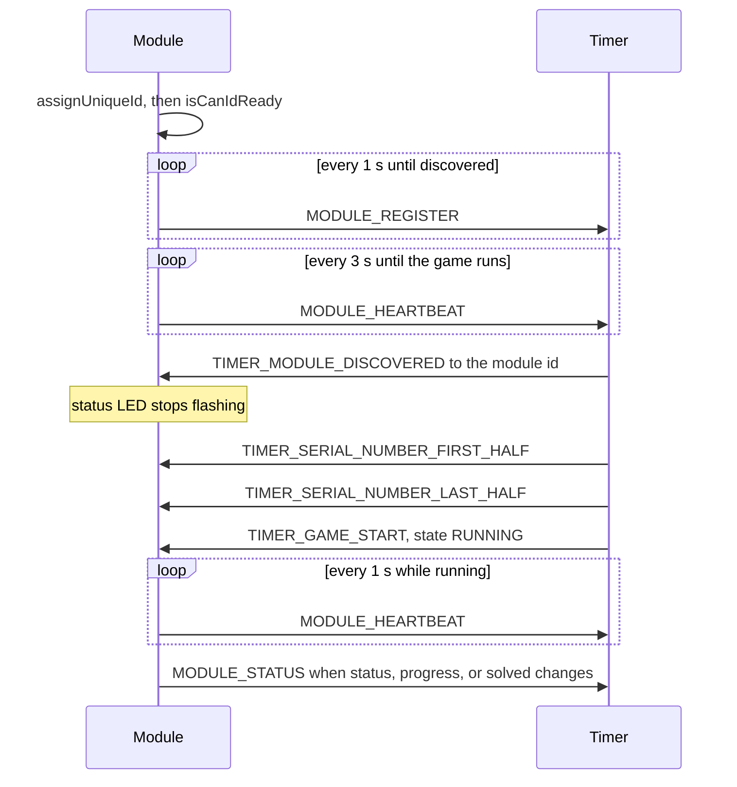

# Module lifecycle

Every module except the timer owns one `ModuleState`, created by `initModuleState`. Calling `initModuleState` on the timer would make the master try to register with itself.

Simon, audio, and the serial tag use the singleton `globalModuleState`. You can also stack-allocate a `ModuleState` and call `begin`. Do not do both in one sketch.

## Join a game



`updateModuleState()` does nothing about registration until `isCanIdReady()` is true. Fixed-id modules (audio, serial tag) are ready as soon as `initCanBus` succeeds.

| Interval | Constant | Value |
|---|---|---|
| Register retry | `MODULE_STATE_REGISTER_INTERVAL` | 1 s |
| Heartbeat before the game runs | `MODULE_STATE_HEARTBEAT_INTERVAL_DISCOVERY` | 3 s |
| Heartbeat during the game | `MODULE_STATE_HEARTBEAT_INTERVAL_GAME` | 1 s |
| Discovery LED | `MODULE_STATE_DISCOVERY_LED_INTERVAL` | 500 ms on / 500 ms off |
| Strike flash | `MODULE_STATE_STRIKE_FLASH_DURATION` | 1 s |

The timer drops a module it has not heard from. Discovery timeout is 6 s (two missed 3 s heartbeats). In-game timeout is 2 s (two missed 1 s heartbeats). Inactive threshold is 5 s. Those live at the top of `timer/lib/game_state/game_state.h`.

Older README text that says "1 s discovery, 5 s in game" is stale. The header constants above are the ones that run.

## What the module reads back

After the matching broadcast:

| Call | Arrives today |
|---|---|
| `isGameRunning()` | yes, from `TIMER_GAME_START` / `TIMER_GAME_STOP` |
| `isDiscoveredByTimer()` | yes, from `TIMER_MODULE_DISCOVERED` |
| `getSerialNumber()` | yes, both halves, 6 characters |
| `getStrikeCount()` | yes, from `TIMER_STRIKES` |
| `getBatteryCount()` / `getEdgework()` | empty until something calls `setEdgework` |

The timer does not currently broadcast a full edgework blob. Write puzzle rules against `hasIndicator`, `hasLitIndicator`, `hasPort`, and the count helpers anyway, so they start working when that message exists.

Indicator labels match the manual: `SND CLR CAR IND FRQ SIG NSA MSA TRN BOB FRK`. Ports: `PARALLEL`, `SERIAL_PORT`, `PS2`, `RJ45`, `RCA`, `DVI`, `STEREO_RCA`.

## Status the timer can show

```cpp
setModuleStateStatus(MODULE_STATUS_ACTIVE);  // IDLE, ACTIVE, SOLVED, ARMED, ERROR
setModuleStateProgress(0..100);
setModuleStateSolved(true);
```

`MODULE_STATUS_ARMED` is for needy modules. `MODULE_STATUS_SOLVED` should agree with `setSolved(true)`. Simon writes both from its phase, and only when the value changed.

Solved-solid on the status LED is not automatic. Simon leaves that LED to the library (discovery flash, then off, plus a 1 s strike flash) and shows solved on the four color LEDs. Call `setLedState(true)` from the solved path if this board's status LED should stay lit.

```cpp
setModuleStateLedPin(11);
setModuleStateLedState(true);     // manual override, solid
clearModuleStateLedOverride();    // back to discovery / strike / off
disableModuleStateLed();
```

Pass `MODULE_STATE_NO_LED` (`-1`) from `initModuleState` when the board has no status LED. Audio and the serial tag do that.

## Strikes and sounds

```cpp
globalModuleState->triggerStrike();                 // MODULE_STRIKE to the timer
globalModuleState->playAudio(AUDIO_PLAY_SIMON_RED);
uint8_t chord[] = {AUDIO_PLAY_BEEP_NORMAL, AUDIO_PLAY_BEEP_HIGH};
globalModuleState->playAudio(chord, 2);             // up to 6 codes
```

Simon's puzzle code calls `sendCanMessage` itself for sounds. Both are valid. Prefer `playAudio` in a new module so `setCommunicationEnabled(false)` suppresses it along with register, heartbeat, and status traffic.

`setDiscovered`, `setGameRunning`, `setStrikeCount`, `setSerialNumber`, and `setEdgework` exist for a bench test with no timer. Leave them unused on a module that is on the bus, or the LED and the real timer will disagree.

## Callbacks

```cpp
globalModuleState->setGameStateCallback([](bool running) {});
globalModuleState->setStrikeCallback([](uint8_t strikes) {});
globalModuleState->setSerialNumberCallback([](const String& serial) {});
globalModuleState->setEdgeworkCallback([](const Edgework& ew) {});
globalModuleState->setDiscoveredCallback([]() {});
```

There is no user-data pointer. Use a file-scope object, as Simon does. `moduleStateHandleCanMessage` must run on every CAN callback or the module never leaves discovery and never learns the serial. It does not consume audio or serial-display commands. Those modules inspect `data[0]` after the call.
