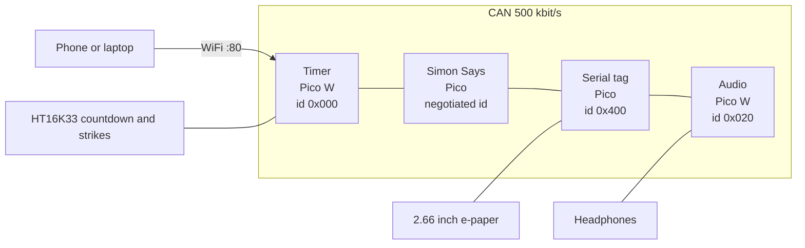
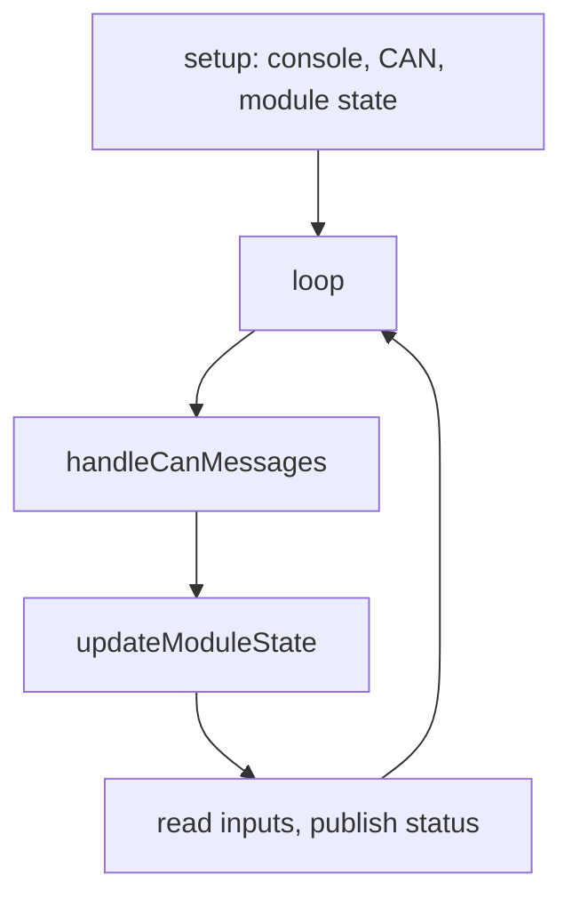

# Architecture

Every module is an Arduino sketch on the Earle Philhower core (`board_build.core = earlephilhower`). Write `setup` / `loop`, `Wire`, `SPI`, and `Serial`. Pico SDK `CMakeLists.txt` and the ArduinoCore-mbed core are unused.

The timer is the only master. It does not use `module_state`. Every other module does.



Only the two boards at the physical ends of the twisted pair enable the on-board 120 ohm jumper (J1).

## What each board owns

| Path | Board | CAN id | Owns |
|---|---|---|---|
| `timer/` | `rpipicow` | `CAN_ID_TIMER` (`0x000`) | Clock, strikes, serial generation, module table, WiFi UI |
| `simon_says/` | `rpipico` | `assignUniqueId(CAN_TYPE_SIMON)` | Buttons, color LEDs, vowel / strike mapping |
| `serial_number/` | `rpipico` | `CAN_ID_SERIAL_DISPLAY` (`0x400`) | 3-color serial tag |
| `audio/` | `rpipicow` | `CAN_ID_AUDIO` (`0x020`) | TLV320DAC3100, I2S mixer, SD WAVs |
| `audio_test/` | `rpipicow` | none | One WAV on the audio hardware, off the protocol |

Infrastructure (`0x00` timer, `0x01` audio) and edgework (`0x20`–`0x2F`) use a fixed instance of 0. Gameplay and needy modules negotiate an instance so two copies can share the bus. Instance 0 on those types is only the negotiation address.

## Two kinds of loop

Most boards run CAN on core 0:



Two boards move the slow work off that path:

- **Serial tag.** Core 0 only services CAN. Core 1 refreshes the e-paper, which takes seconds.
- **Audio, with `-DEDGE_AUDIO`.** Core 0 only runs the I2S mixer. Core 1 services CAN, the SD card, and the play queue.

A core blocked in a multi-second refresh or an SD read must not be the only place `handleCanMessages()` runs. `handleCanMessages()` is not safe to call from both cores. Do not use `delay` on the core that owns CAN.

## Repository map

```text
KTANE/
├── timer/                 Pico W master
├── simon_says/            gameplay module, and the template for the next one
├── serial_number/         e-paper edgework
├── audio/                 sound module
├── audio_test/            audio-board bench sketch
├── shared_libs/
│   ├── can_bus/           wire protocol and MCP2515 driver
│   ├── module_state/      registration, heartbeat, strikes, serial
│   └── ktane_console/     Serial or Picoprobe Serial1
├── firmware/              UF2 files copied by build_all.ps1
├── build/<module>/        PlatformIO output
├── DOCS/                  paper bomb manual (PDF)
└── docs/                  this guide
```

`build_all.ps1` discovers every root directory that contains `platformio.ini`, except names it excludes and names matching `can_debug*` / `can_test*`. `test_modules/` is a nested folder, so those sketches stay out of the all-modules build.

## Rules that keep modules in sync

- Call `ktaneConsoleInit` once, then log with `KTANE_CONSOLE_OUT`. With `-DKTANE_PICOPROBE_UART` that is `Serial1` on GP0/GP1. Leave those pins free on every board.
- Publish puzzle state with `setModuleStateStatus`, `setModuleStateProgress`, and `setModuleStateSolved`.
- Play sounds by sending a one-byte `AudioMessage` to `CAN_ID_AUDIO`, or `globalModuleState->playAudio(...)`.
- Generate puzzles from `getSerialNumber()`, `getStrikeCount()`, and `getEdgework()` after the timer has sent them. Read the paper manual for the real rule table.
- `randomSeed(rp2040.hwrand32())` on boards that need entropy. The RP2040 boot state is a poor seed.
- `can_bus` calls `SPI.begin()` itself and owns SPI0. Put SD cards and e-paper on SPI1.
- `Wire` / `SPI` pin remaps happen before `begin()`.
- Flash writes (`EEPROM.commit` on the timer) stall the other core.
- Lock SdFat with the mutex in `audio/lib/sd_card` if both cores touch the card.
- Keep ArduinoJson on major version 6 (`bblanchon/ArduinoJson@^6.21.0`). Version 7 removes `DynamicJsonDocument`.

## Side-module numbers that are not on the wire

`timer/lib/game_state/game_state.h` lists serial, indicators, batteries, and ports as `0x40`–`0x43`. Those values are not CAN type codes. Encode and decode with the constants in `shared_libs/can_bus/can_bus.h` (`CAN_TYPE_SERIAL_DISPLAY` is `0x20`, id `0x400`).
