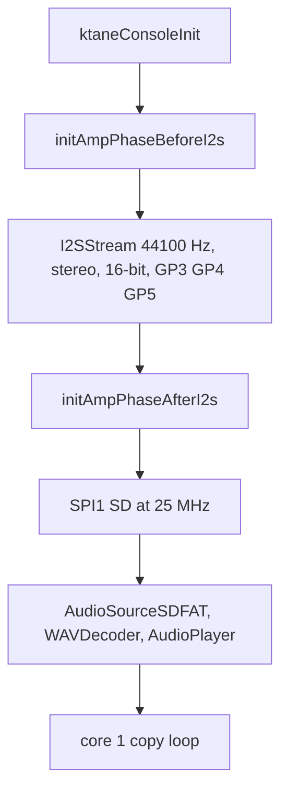

# Audio test

`audio_test/` is a Pico W bench sketch for the audio board. It is not on the bomb protocol. It does not call `initCanBus`. `mcp_can` is linked and unused. Leave the bus quiet while this sketch owns SPI1 and I2S, or run it on a board that is off the bus.

`lib_extra_dirs` includes `../shared_libs` and `../audio/lib`, so the sketch can see `sound_bank`, `sd_card`, and `amp` pins and paths. It does not run the bomb mixer.

## What it plays

`src/main.cpp` loops `AUDIO_PLAY_TITLE`, which is `/sounds/title.wav`.



I2S buffer settings, chosen so `I2S::begin` does not treat the size as a huge word count:

| Setting | Value |
|---|---|
| `buffer_size` | 1536 DMA words |
| `buffer_count` | 14 |
| Player buffer | 16384 bytes |
| `setDelayIfOutputFull` | 1 |
| `copy()` | core 1, 24 calls per `loop1` pass |

`getSoundFilePath` returns a path with a leading slash. The sketch strips one slash before SdFat sees it.

Core 0 stays free for USB. That split is the point of this sketch. A `buffer_size` in the tens of thousands hangs inside `I2S::begin` because the core treats the number as words.

## When to change which sketch

Change `audio_test` to prove a file, a clock, or a buffer setting. Copy a setting into `audio/lib/audio_mixer` only after this sketch plays cleanly. The mixer is mono and writes its own blocks. Pasting the 14-buffer stereo config across unchanged will exhaust RAM.

## Flash

Card contents and codec pins match [Audio setup](../audio/setup.md). The SPI clock here is 25 MHz. The bomb audio sketch tries 10 MHz and falls back to 1 MHz.

```powershell
cd audio_test
pio run --target upload
pio device monitor
```

`board` is `rpipicow`. Build flag is only `-DKTANE_PICOPROBE_UART`. There is no `-DEDGE_AUDIO` and no Bluetooth flag.

You should hear `title.wav` repeat. If the bomb mixer is silent and this sketch is also silent, the fault is the codec, the I2S pins, or the card, not CAN. If this sketch plays and the bomb build does not, look at the mixer, the core split, and the play queue in `audio/`.
