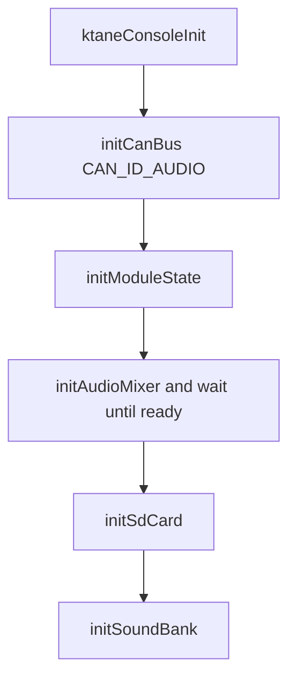
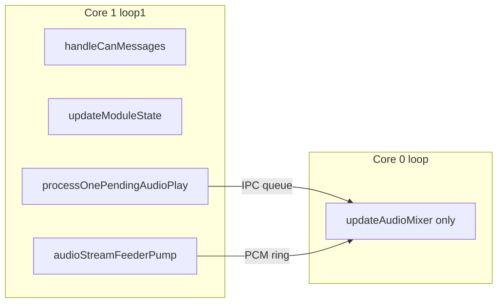

# Audio

`audio/` is a Pico W (`board = rpipicow`) at fixed id `CAN_ID_AUDIO` (`0x020`). It is not a solvable module. Other modules request sounds. This one plays them through a TLV320DAC3100 into headphones.

`initModuleState(MODULE_STATE_NO_LED)`. The module still heartbeats so the timer can show it connected.

Build flags:

| Flag | Effect |
|---|---|
| `-DEDGE_AUDIO` | Two-core scheduler. This is the bomb build. |
| `-DPIO_FRAMEWORK_ARDUINO_ENABLE_BLUETOOTH` | Compiles the Bluetooth stack. `lib/bluetooth/` can scan and open an A2DP source. `main.cpp` never calls it. |
| `-DKTANE_PICOPROBE_UART` | Console on GP0/GP1. |

The boot log prints `CAN bus ready (ID=C0)`. That string is stale. The id programmed by `initCanBus(CAN_ID_AUDIO)` is `0x020`.

`audio/lib/audio/audio.h` still lists I2S on GP6, GP7, and GP8. The running mixer does not use that header. Pins below are `audio_mixer.h` and `amp.h`.

## Pins

| Function | GPIO |
|---|---|
| I2S BCLK, WSEL, DIN | GP3, GP4, GP5 |
| Codec I2C `Wire1` SDA, SCL | GP6, GP7 |
| Codec reset, active low | GP8 |
| SD SPI1 MISO, CS, SCK, MOSI | GP12, GP13, GP14, GP15 |
| CAN SPI0 | CS GP17, INT GP20, plus GP16/GP18/GP19 |
| Console | GP0 / GP1 |

## Boot order

The mixer starts before the SD card so codec I2C and the first I2S clocks come up before SPI1 is active. Inside the mixer the codec order is phase 1, `I2SStream.begin`, phase 2. Phase 1 programs the TLV320 PLL dividers. Phase 2 runs after BCLK exists so the PLL can lock.

If the card is missing, CAN and the mixer still come up. Streaming sounds fail until a card is inserted and the board is reset. `lib/sd_test/` can list a card. It is not part of boot.

## Cores

`-DEDGE_AUDIO` splits the chip like this:

`ktaneAudioBlockingYield` runs from long SD reads so CAN still runs on core 1. SdFat calls take `audioSdLock()` so the two cores never talk to the card at once.

Without `EDGE_AUDIO`, one `loop` interleaves eight mixer updates with CAN and one pending sound. Use that only on the bench. Do not ship it. The headphone clock wants core 0 to itself.

Do not call `playSound` from core 0 under `EDGE_AUDIO`. The feeder and the pending-play path hop the lock-free IPC queue (`audio_mixer_ipc.h`). Six RAM voices. Stream slots are filled on core 1 and consumed on core 0.

## Choosing a sound

The CAN callback calls `moduleStateHandleCanMessage` first, then if `id == CAN_ID_AUDIO`:

- `AUDIO_SET_VOLUME` (`0x60`) plus a percent byte calls `setAudioMixerVolume`. This scales mixed PCM. It does not rewrite the codec PGA. Range 0..100, default 20.
- Any other byte is queued (8 deep) and played from core 1, one at a time. A full queue drops the request.

`getSoundFromBank`:

| Status | What happens |
|---|---|
| `Success` | PCM fits in RAM. `playSound(samples, count)` with a sample count, not a byte count. |
| `FileTooLarge` | `playSoundFromFile(path)` streams it. |
| `SoundNotRegistered`, open error, read error | Logged and dropped. |

The stream path accepts mono or stereo 16-bit PCM at 44100 Hz only. Any other rate is refused, because the codec PLL is fixed for that clock. The bank loader warns on unusual rates and can still return samples. Prefer 44100 Hz files for both paths.

The callback sets `MODULE_STATUS_ACTIVE` around a play and `IDLE` after. That flip is short. It is not "busy for the length of the WAV".

Files, volume, and how to add one: [Sound bank](sound-bank.md). Wiring and the card: [Setup](setup.md).
