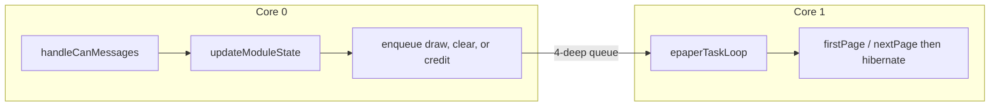

# Serial number

`serial_number/` is edgework, not a solvable puzzle. It runs on a Pico (`board = rpipico`) at fixed id `CAN_ID_SERIAL_DISPLAY` (`0x400`, type `0x20`, instance 0). `initModuleState(MODULE_STATE_NO_LED)`.

Build flags: `-DEDGE_SERIAL_NUMBER` (set, not read by current sources) and `-DKTANE_PICOPROBE_UART`.

## Cores

A refresh of the 2.66 inch 3-color panel takes seconds. That work stays on core 1 so discovery heartbeats keep running.

`loop` on core 0 is only `handleCanMessages()` and `updateModuleState()`. `setup()` also spins for about 5 seconds calling those two functions so the panel task can start without stalling the bus.

## How the serial reaches the glass

Two paths queue a tag:

- `module_state` reassembles `TIMER_SERIAL_NUMBER_FIRST_HALF` and `TIMER_SERIAL_NUMBER_LAST_HALF` and calls `onSerialNumberReceived`, which queues `epaperDrawTag`. This is the path the timer uses.
- A direct `SERIAL_DISPLAY_SET_SERIAL` (`0x30`) with 6 payload bytes still queues a tag. That frame is 7 bytes and `sendCanMessage` drops it, so nothing on the bomb sends it today. `SERIAL_DISPLAY_CLEAR` (`0x31`) and `SERIAL_DISPLAY_SHOW_CREDIT` (`0x32`) fit in one byte.

While a display command is handled, status flips to `MODULE_STATUS_ACTIVE` and back to `IDLE` in the same callback. The long work is the core-1 refresh, not this callback.

Enqueue from core 0 only. Draw inside the `execute*` functions on core 1, inside `firstPage` / `nextPage`, then `hibernate()`. The queue head and tail are atomic. A full queue (4 commands) returns false from `epaperDrawTag`. The caller currently ignores that.

## Panel

`GxEPD2_3C<GxEPD2_266c, GxEPD2_266c::HEIGHT>` on SPI1.

| Signal | GPIO |
|---|---|
| CS | GP5 |
| DC | GP6 |
| RST | GP7 |
| BUSY | GP8 |
| SCK | GP10 |
| MOSI | GP11 |

`init` uses `SPISettings(115200, MSBFIRST, SPI_MODE0)`, rotation 1, a full window, and `hibernate()` after each frame. There is no MISO pin. The panel is write-only.

Tag layout: the top half is filled `GxEPD_RED` with `SERIAL #` in `resolution_medium24pt7b`, drawn white. The bottom half is the 6-character serial in `resolution_medium36pt7b`, drawn black. The credit frame says `KTANE IRL` / `By Rhys Lees`. Fonts are `GFXfont` headers in `lib/fonts/`.

## GP8 is named twice

`setup()` calls `Wire.setSDA(8)`, `Wire.setSCL(9)`, and `Wire.begin()`. The panel does not use I2C. `EPD_BUSY` is also GP8. Do not attach an I2C device to GP8 while the panel's BUSY line is wired there. The `Wire.begin()` call is leftover headroom for a later sensor. If you add one, move it off GP8, or move BUSY.

Do not point the panel at the default `SPI` object. SPI0 belongs to the MCP2515.

Wiring and flash: [Setup](setup.md).
