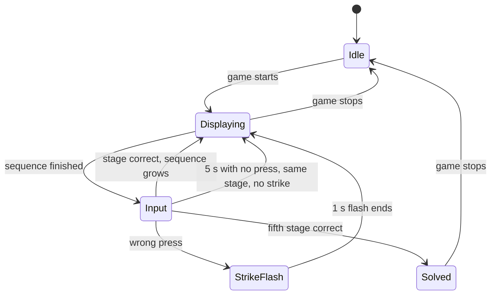

# Simon Says

`simon_says/` is the gameplay module on a Pico (`board = rpipico`), and the template for the next puzzle. It takes a negotiated CAN id, uses `module_state`, applies the manual's vowel and strike tables, and sends sounds to the audio module.

`src/main.cpp` owns the bus. `lib/simon_says/` owns the puzzle and the GPIO. Trust `simon_says.h` for pins and sequence length. The module README's pin table and its "starts at 3 colors" line disagree with the header.

`platformio.ini` also passes `-DEDGE_SERIAL_NUMBER`. Simon's sources do not read that flag. It was copied from the serial-tag project. The flag that matters is `-DKTANE_PICOPROBE_UART`.

## Pins

Status LED is GP11, passed to `initModuleState`.

`COLOR_ORDER` is red, blue, green, yellow. `LED_PINS` and `BUTTON_PINS` follow that order.

| Color | Button (`INPUT_PULLUP`, pressed = LOW) | LED (HIGH = on) |
|---|---|---|
| Red | GP2 | GP6 |
| Blue | GP4 | GP8 |
| Green | GP3 | GP7 |
| Yellow | GP5 | GP9 |

`begin()` drives every LED high once, then `update()` takes over.

| Timing | Value |
|---|---|
| Debounce | 30 ms |
| Display flash | 500 ms |
| Gap between flashes | 200 ms |
| Input timeout | 5 s |
| Strike flash | 1 s |
| Opening sequence length | 1 |
| Maximum sequence length | 5 |

## Phases

`main.cpp` maps `Idle` to `MODULE_STATUS_IDLE`, `Solved` to `MODULE_STATUS_SOLVED`, and anything else to `MODULE_STATUS_ACTIVE`. Progress and the solved flag are written only when they change.

Progress percent is completed stages over five. Completing the opening stage (length 1) reports 20. The solved phase forces 100.

`onGameStateChanged(false)` resets status, solved, and progress. `onGameStateChanged(true)` marks the module active. Serial and strike callbacks call `simonSays.setSerialNumber` and `setStrikeCount`.

A wrong press calls `registerStrike` (local bookkeeping plus `AUDIO_PLAY_STRIKE`) and `main.cpp` turns the rising edge of `consumeStrikeTriggered()` into `triggerStrike()`. Timing out a stage is not a strike.

## Sounds

`sendAudio` is `sendCanMessage(CAN_ID_AUDIO, {code}, 1)`.

Display flashes use `AUDIO_PLAY_SIMON_RED`, `BLUE`, `GREEN`, `YELLOW` in color order. Button presses use `AUDIO_PLAY_BEEP_NORMAL`, `AUDIO_PLAY_CORRECT_TIME`, `AUDIO_PLAY_BEEP_HIGH`, `AUDIO_PLAY_BEEP_FAST` in that same order. Solved sends `AUDIO_PLAY_DEFUSED`.

The puzzle library includes `can_bus.h` only. `main.cpp` includes `module_state.h`. Keep that split so a new puzzle does not create an include cycle.

Rules: [Rules](rules.md). Wiring and flash: [Setup](setup.md).
