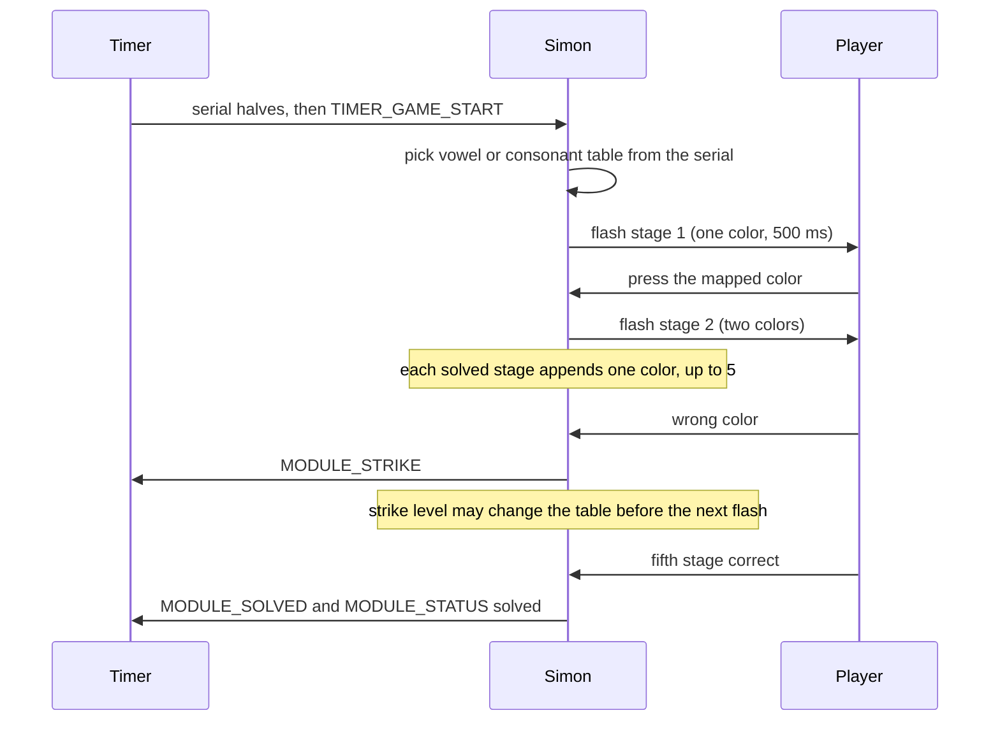

# Simon Says rules

The mapping is the official Simon Says table from the bomb manual. `mapFlashToPress` indexes `[strikeLevel 0..2][color]`. Strike level clamps at 2. An empty serial uses the consonant table. A vowel is `A`, `E`, `I`, `O`, or `U` in the six-character serial, any case the callback stored.

Colors in each row are the button to press when the flash is red, blue, green, then yellow.

## Vowel in the serial

| Strikes | Red flash | Blue flash | Green flash | Yellow flash |
|---|---|---|---|---|
| 0 | Blue | Red | Yellow | Green |
| 1 | Yellow | Green | Blue | Red |
| 2 or more | Green | Red | Yellow | Blue |

## No vowel

| Strikes | Red flash | Blue flash | Green flash | Yellow flash |
|---|---|---|---|---|
| 0 | Blue | Yellow | Green | Red |
| 1 | Red | Blue | Yellow | Green |
| 2 or more | Yellow | Green | Blue | Red |

## Round shape

The sequence is generated up front (`generateFullSequence`) and revealed one stage at a time. It does not reshuffle when a strike arrives. Only the mapping table changes.

The serial used for the vowel test is whatever `module_state` has reassembled. If you press before both halves have arrived, the module treats the serial as empty and uses the consonant table until the callback fires.
