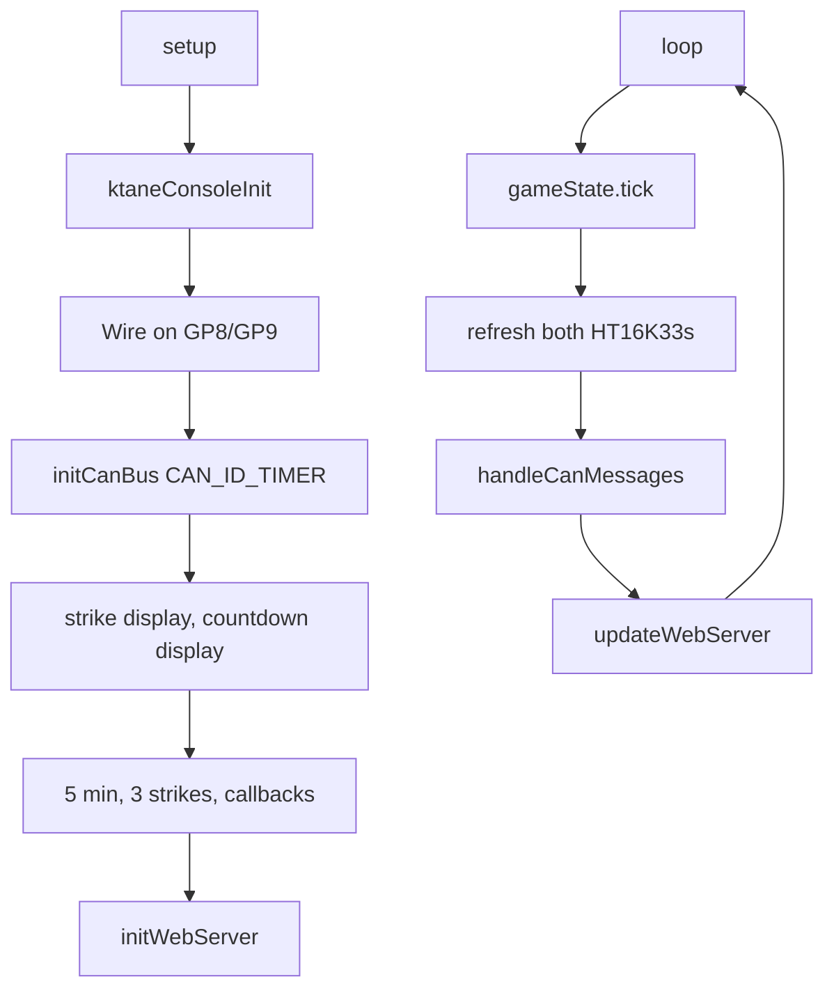
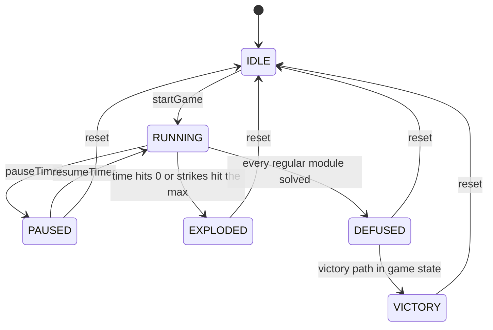

# Timer

`timer/` is the only master. It runs on a Pico W (`board = rpipicow`). It broadcasts game state and collects `MODULE_*` frames. It does not call `initModuleState`.

Build flags: `-DMODULE_TIMER` (set, not read by current sources) and `-DKTANE_PICOPROBE_UART`.

## What it does each pass

`updateWebServer()` stays on core 0. There is no `loop1`.

`onTimerCanMessage` handles `MODULE_REGISTER`, `MODULE_STRIKE`, `MODULE_SOLVED`, `MODULE_STATUS`, and `MODULE_HEARTBEAT` by calling `gameState.handleCanMessage`. Anything else is ignored.

## Hardware

| Device | Bus | Address or pins |
|---|---|---|
| Countdown, `Adafruit_7segment` | `Wire` I2C0, SDA GP8, SCL GP9 | `0x70` |
| Strikes, raw HT16K33 | same `Wire` | `0x74` |
| CAN | SPI0 | CS GP17, INT GP20 |
| Console | `Serial1` | GP0 TX, GP1 RX |
| WiFi | Pico W radio | AP `KTANE_TIMER_SETUP` until credentials are stored |

GP0 and GP1 stay free for the probe. I2C is on GP8/GP9 on purpose, not the Pico default GP4/GP5. The comment in `setupHardware` records that.

Details: [Setup](setup.md), [Displays](displays.md), [Web UI](web-api.md).

## Game configuration

`setupGameConfig` in `src/main.cpp`:

| Field | Value |
|---|---|
| Time limit | 300000 ms (5 minutes) |
| Max strikes | 3 |
| Strike acceleration | on, factor 0.25 (25% faster per strike) |
| Emergency alarm | on, threshold 60000 ms |
| Needy modules | enabled in config |
| Edgework | enabled in config |

`initialize()` builds the serial number and the edgework for the round. Serial halves are broadcast. A full edgework blob is not currently broadcast. See [Module lifecycle](../../architecture/module-lifecycle.md).

## States

`startGame()` is the entry that tells modules and then runs the clock. `tick()` advances the clock, needy bookkeeping, timeouts, and the win/lose checks.

Callbacks wired in `main.cpp`:

| Event | On the bus | Sound to `CAN_ID_AUDIO` |
|---|---|---|
| Entered `EXPLODED` | `TIMER_GAME_STOP` plus the `GameState` byte | `AUDIO_PLAY_EXPLODED` |
| Entered `DEFUSED` | `TIMER_GAME_STOP` | `AUDIO_PLAY_DEFUSED` |
| Entered `VICTORY` | `TIMER_GAME_STOP` | `AUDIO_PLAY_GAME_OVER_FANFARE` |
| Any other state change | `TIMER_GAME_START` if the new state is `RUNNING`, otherwise `TIMER_GAME_STOP` | |
| Strike count changed, and the count is non-zero | `TIMER_STRIKES` | `AUDIO_PLAY_STRIKE` |
| A module solved | | `AUDIO_PLAY_CORRECT_TIME` |
| Time callback | `TIMER_TIME` (type byte plus 4-byte `unsigned long` milliseconds) at 2 Hz | |

The countdown display sends the once-per-second beeps and the emergency alarm itself. See [Displays](displays.md).

## Libraries compiled in, not started

`timer/lib/lcd1602/` is a Waveshare RGB1602 driver: character controller `(0x7C >> 1)` = `0x3E`, RGB controller `(0xC0 >> 1)` = `0x60`, on a `TwoWire` you pass in. `timer/lib/debug/debug.cpp` draws menus on it. `main.cpp` does not call `initLcd1602` or the debug menu. `serial_command/` and `module_tracker/` are also present and not referenced from `main.cpp`. Wire them from `setup` if you revive that UI.

## Side-module enum

`ModuleType::SERIAL_DISPLAY` in `game_state.h` is `0x40`. The wire type is `CAN_TYPE_SERIAL_DISPLAY` (`0x20`, id `0x400`). Outbound ids must use `CAN_ID_*` from `can_bus.h`.

## Useful `GameStateManager` calls

The web API already uses these: `startGame`, `pauseTimer`, `resumeTimer`, `reset`, `addStrike`, `clearStrikes`, `setTimeLimit`, `setStrikes`, `getState`, `getRemainingTime`, `getStrikes`, `getAllModules`, `getSerialNumber`, `getEdgework`, `setAudioVolume`.
